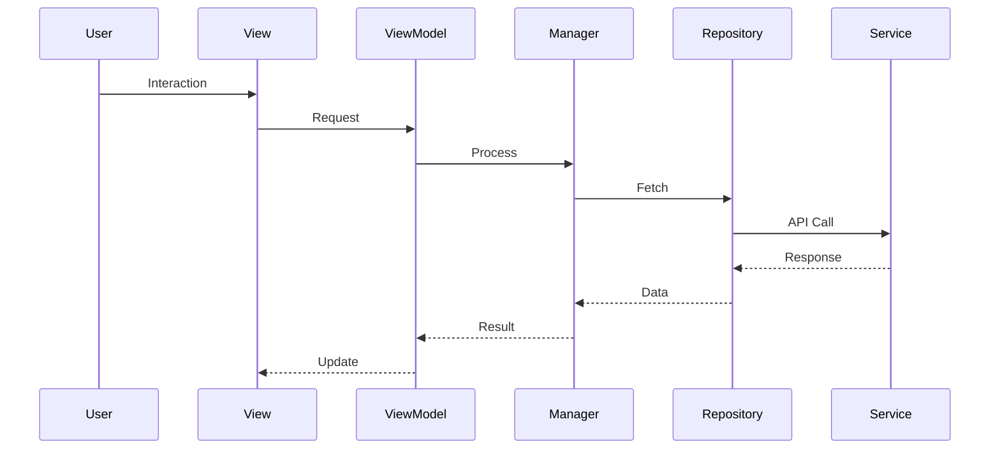

# Design Document Template

> **Template Version**: 1.0.0
> **Use For**: Phase 3 (Design) - Primary Deliverable  
> **Gate**: Gate 3 (Design Complete)
> **Based On**: Constitution Principles I, II, III, IV, VI, VIII, IX

---

## Purpose

This template guides the creation of a **Design Document** that translates specifications into detailed technical design, documents architecture decisions, and provides implementation guidance. **Required to pass Gate 3**.

---

## Template

```markdown
# Design Document: [Feature Name]

**Feature ID**: FEA-[YYYYMMDD]-[XXX]
**Spec ID**: SPE-[YYYYMMDD]-[XXX]
**Research ID**: RES-[YYYYMMDD]-[XXX]
**Date**: YYYY-MM-DD
**Author**: [Name]
**Status**: [Draft | In Review | Approved]

## Revision History

| Version | Date | Author | Changes | Status |

---

## Executive Summary

[High-level overview: key design decisions, architecture overview, primary goals.]

---

## References

- [idea.md](../../03-ideas/idea-[feature-id].md)
- [specification.md](../../03-ideas/specs/spec-[spec-id].md)
- [research.md](../../03-ideas/research/research-[research-id].md)
- [constraints.md](../../03-ideas/constraints/constraints-[constraints-id].md)
- [risks.md](../../03-ideas/risks/risks-[risks-id].md)
- [Constitution](../../00-constitution/constitution.md)

---

## Architecture Overview

### Architecture Diagram

[ASCII or Mermaid diagram showing components and relationships]

**Example (ASCII)**:
```
+-------------------+       +-------------------+       +-------------------+
|   Presentation    |       |   Business Logic  |       |       Data        |
|      Layer        |       |       Layer       |       |      Layer        |
+-------------------+       +-------------------+       +-------------------+
        ^                           ^                           ^
        |                           |                           |
+-------------------+       +-------------------+       +-------------------+
| DevelopmentModuleView |       | ProjectManager    |       | ProjectService    |
| DevelopmentSettingsView|       | LocationManager   |       | ProjectRepository |
+-------------------+       | CacheManager      |       +-------------------+
                              +-------------------+
```

### Architecture Pattern

**Pattern**: [MVVM / Clean Architecture / etc.]
**Rationale**: [Why this pattern was chosen]

### Layer Dependencies

```
Presentation Layer (SwiftUI)
    ↓
Business Logic Layer (ViewModels)
    ↓
Data Layer (Models, Services, Repositories)
    ↓
External Systems (APIs, CoreLocation, SwiftData)
```

**Dependency Rules**:
- ✅ Presentation → Business Logic
- ✅ Business Logic → Data
- ❌ Data → Business Logic (no circular dependencies)
- ❌ Presentation → Data (go through ViewModels)

---

## Component Design

### Presentation Layer

#### [View Name]View

**Description**: [Purpose of this view]
**Responsibilities**: [List responsibilities]
**Properties**: [Code snippet of key properties]
**Subcomponents**: [List of subcomponents]
**User Interactions**: [List of user interactions]

---

### Business Logic Layer

#### [Manager/ViewModel Name]

**Description**: [Purpose of this component]
**Responsibilities**: [List responsibilities]
**Dependencies**: [List dependencies]
**Key Methods**: [List key methods with brief descriptions]

---

### Data Layer

#### Data Models

```swift
// Example data models
struct CurrentProject: Codable, Identifiable {
    let id: UUID
    let locationID: UUID
    let timestamp: Date
    let status: Status
    let conditions: ProjectConditions
    // ... other properties
}

@Model
final class PersistentProject {
    @Attribute(.unique) var id: UUID
    var timestamp: Date
    var statusMetric: Double
    // ... other properties
    
    var location: PersistentLocation?
}
```

#### [Service/Repository Name]

**Description**: [Purpose of this service/repository]
**Responsibilities**: [List responsibilities]
**Interface**: [Protocol definition]
**Implementation**: [Key implementation details]

---

## Data Flow

[Description of how data flows through the system]

### [Flow Name] Flow



---

## Error Handling

### Error Types

```swift
enum ProjectError: Error, LocalizedError {
    case networkError(Error)
    case apiError(APIError)
    case locationDenied
    case noCachedData
    case unknown
    
    var errorDescription: String? { ... }
}
```

### Error Handling Strategy

| Error Type | Recovery Strategy | User Action Required |
|------------|-------------------|----------------------|
| Network Error (temporary) | Retry automatically | No |
| Network Error (no connection) | Use cached data | No (show stale indicator) |
| Location Denied | Show settings option | Yes |

---

## State Management

[Design for managing application state]

### State Diagram

```
States:
  [idle] --(fetch)--> [loading]
  [loading] --(success)--> [loaded]
  [loading] --(offline, has cache)--> [offline]
  [loading] --(error, no cache)--> [error]
  [loaded] --(refresh)--> [loading]
```

### State Properties

```swift
@MainActor
final class ProjectViewModel: ObservableObject {
    @Published private(set) var state: ProjectState = .idle
    @Published private(set) var currentProject: CurrentProject?
    @Published private(set) var error: ProjectError?
    @Published private(set) var isLoading = false
    
    enum ProjectState {
        case idle, loading, loaded, error, offline
    }
}
```

---

## Security Design

### Constitution Principle Compliance

- **D.1 (No hardcoded secrets)**: No API keys in code
- **D.2 (Secure transmission)**: HTTPS for all network calls
- **D.3 (Data at rest)**: File protection for sensitive data
- **VIII (Personal data)**: Location data requires consent, minimal storage

---

## Performance Design

### Performance Goals

| Goal | Target | Measurement |
|------|--------|-------------|
| Initial load time | < 500ms | Widget render to display |
| Network request time | < 2s | Request to response |
| Memory usage | < 10MB | Memory footprint |

### Performance Optimizations

- Network: HTTP/2, request throttling, caching
- Data: Limit cache size, auto-clean stale data
- UI: Lazy loading, minimize re-rendering
- Computation: Background threads for expensive operations

---

## Testing Design

### Test Types & Coverage

| Test Type | Tools | Coverage Target |
|-----------|-------|-----------------|
| Unit Tests | XCTest | 100% business logic |
| Integration Tests | XCTest | Key integration points |
| UI Tests | XCTest UI Testing | Critical user flows |

### Test Doubles

- **Mocks**: MockProjectService, MockLocationManager
- **Stubs**: StubURLSession, StubCLLocationManager  
- **Fakes**: FakeModelContext

---

## Accessibility Design

### Compliance

- ✅ Dynamic Type support
- ✅ Dark Mode support
- ✅ Reduced Motion support
- ✅ VoiceOver support
- ✅ Keyboard navigation
- ✅ Color contrast (4.5:1 minimum)

### Implementation

```swift
Text(viewModel.displayStatus)
    .accessibilityValue("Status: \(viewModel.displayStatus)")
    .accessibilityHint("Current status")
```

---

## Internationalization

### Localization

- Support: English (en), Spanish (es), French (fr), German (de)
- Use `Localizable.xcstrings`
- Locale-aware formatting for dates, numbers, statuss

---

## Cross-Dependency Analysis

**Checklist**: Use `05-checklists/cross-dependency-checklist.md`

### Related Features

| Feature | Relationship | Impact | Coordination |
|---------|--------------|--------|--------------|
| Dashboard | Contains widget | Medium | Widget sizing |
| Calendar Widget | Shares framework | Low | Follow patterns |

### Shared Resources

| Resource | Usage | Impact | Coordination |
|----------|-------|--------|--------------|
| Widget Framework | Base classes | High | Follow conventions |
| Location Service | Location detection | Medium | Reuse service |
| SwiftData | Persistence | High | Follow conventions |

---

## Constitution Verification

[Verify alignment with all Constitution Principles]

- [ ] Principle A (Technology Stack)
- [ ] Principle B (Integration)
- [ ] Principle C.1 (Concurrency)
- [ ] Principle C.2 (Threading)
- [ ] Principle D.1 (No secrets)
- [ ] Principle D.2 (HTTPS)
- [ ] Principle II (Tested logic)
- [ ] Principle III (Simplicity)
- [ ] Principle IV (Testing)
- [ ] Principle VI (Intuitive)
- [ ] Principle VII (Error handling)
- [ ] Principle VIII (Privacy)
- [ ] Principle IX (Local-first)
- [ ] Principle X (Performance)

---

## Implementation Plan

### Phase 1: Foundation
- [ ] Project structure
- [ ] Data models
- [ ] SwiftData setup
- [ ] ProjectService
- [ ] ProjectRepository

### Phase 2: Business Logic
- [ ] ProjectManager
- [ ] LocationManager
- [ ] ViewModels

### Phase 3: Presentation
- [ ] DevelopmentModuleView
- [ ] DevelopmentSettingsView
- [ ] Accessibility
- [ ] Localization

### Phase 4: Integration
- [ ] Dashboard integration
- [ ] Settings integration
- [ ] End-to-end testing

### Phase 5: Testing & Polish
- [ ] Unit tests
- [ ] UI tests
- [ ] Edge cases
- [ ] Bug fixes

---

## Open Questions

**CRITICAL**: MUST BE EMPTY TO PASS GATE 3

## Decisions

[List all design decisions]

---

## Checklist

**Before Gate 3 submission**:
- [ ] All sections complete
- [ ] Constitution verification complete
- [ ] Open Questions is EMPTY
- [ ] All design decisions documented
- [ ] Cross-dependency analysis complete

---

## Notes for Agents

✅ **Do**:
- Follow Constitution Principles
- Design for testability
- Consider edge cases
- Reuse existing patterns
- Document rationale

❌ **Don't**:
- Skip sections
- Over-engineer
- Violate Constitution
- Submit with open questions

---

## Related Documents

- [Gate 3 Definition](../../02-methodology/checkpoints/gate-03.md)
- [Gate 3 Checklist](../../05-checklists/gate-03-checklist.md)
- [Specification Template](specification-template.md)
- [Constitution](../../00-constitution/constitution.md)
