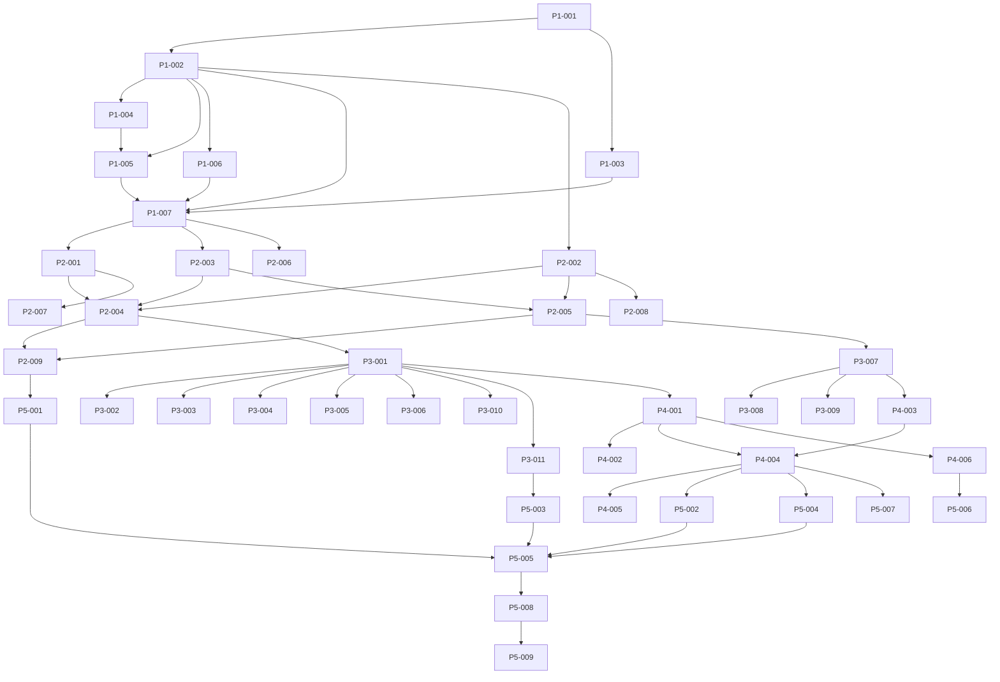

# Implementation Plan Template

> **Template Version**: 1.0.0
> **Use For**: Phase 4 (Implementation) - Primary Deliverable
> **Gate**: Gate 4 (Implementation Complete)
> **Based On**: Constitution Principles I, II, IV, V

---

## Purpose

This template guides the creation of an **Implementation Plan** that:
- Breaks down implementation into manageable tasks
- Assigns responsibility for each task
- Sets timelines and dependencies
- Tracks progress
- Ensures nothing is missed

**Critical**: The Implementation Plan is required to pass **Gate 4** (Implementation Complete).

---

## Template

```markdown
# Implementation Plan: [Feature Name]

**Feature ID**: FEA-[YYYYMMDD]-[XXX]
**Design ID**: DES-[YYYYMMDD]-[XXX]
**Spec ID**: SPE-[YYYYMMDD]-[XXX]
**Date**: YYYY-MM-DD
**Author**: [Agent or Human Name]
**Status**: [Draft | In Progress | In Review | Approved]

## Revision History

| Version | Date | Author | Changes | Status |
|---------|------|--------|---------|--------|
| 1.0.0 | YYYY-MM-DD | [Name] | Initial plan | Draft |

---

## Executive Summary

[High-level overview of the implementation approach.

**Include**:
- Total number of tasks
- Estimated timeline
- Key milestones
- Risk level
- Resource requirements

**Example**:
> This implementation plan covers the Project Data Widget feature (FEA-20261029-001) with **42 tasks** organized into **5 phases** over **14 days**.
>
> **Key Milestones**:
> - Phase 1 (Foundation): Days 1-3 (7 tasks)
> - Phase 2 (Business Logic): Days 4-6 (9 tasks)
> - Phase 3 (Presentation): Days 7-9 (11 tasks)
> - Phase 4 (Integration): Days 10-11 (6 tasks)
> - Phase 5 (Testing): Days 12-14 (9 tasks)
>
> **Risk Level**: 🟡 Medium (tight timeline, but well-scoped)
> **Resources**: Solo developer + AI agents, 6 hours/day
]

---

## References

[List all related documents]

- [idea.md](../../03-ideas/idea-[feature-id].md)
- [specification.md](../../03-ideas/specs/spec-[spec-id].md)
- [design.md](../../03-ideas/design/design-[design-id].md)
- [research.md](../../03-ideas/research/research-[research-id].md)
- [constraints.md](../../03-ideas/constraints/constraints-[constraints-id].md)
- [risks.md](../../03-ideas/risks/risks-[risks-id].md)
- [Constitution](../../00-constitution/constitution.md)

---

## Project Information

[Key information about the implementation project]

### Team

| Role | Name | Responsibility | Hours/Day | Days Available |
|------|------|----------------|-----------|----------------|
| Developer | [Human Name] | Architecture, review | 2 | All |
| Agent | [Agent Name] | Implementation | 4 | All |

### Timeline

| Phase | Start Date | End Date | Duration | Tasks | Status |
|-------|------------|----------|----------|-------|--------|
| Phase 1: Foundation | 2026-10-29 | 2026-10-31 | 3 days | 7 | [ ] |
| Phase 2: Business Logic | 2026-11-01 | 2026-11-03 | 3 days | 9 | [ ] |
| Phase 3: Presentation | 2026-11-04 | 2026-11-06 | 3 days | 11 | [ ] |
| Phase 4: Integration | 2026-11-07 | 2026-11-08 | 2 days | 6 | [ ] |
| Phase 5: Testing | 2026-11-09 | 2026-11-11 | 3 days | 9 | [ ] |
| **Total** | **2026-10-29** | **2026-11-11** | **14 days** | **42** | | |

### Budget

| Resource | Cost | Notes |
|----------|------|-------|
| Developer Time | 14 days x 6 hours = 84 hours | Solo developer + agents |
| Tools | $0 | No paid tools required |
| APIs | $0 | SampleProvider is free |
| **Total** | **84 hours** | **$0** |

---

## Risk Assessment

[Assessment of implementation risks]

### Implementation Risks

| Risk | Likelihood | Impact | Mitigation | Owner | Status |
|------|------------|--------|------------|-------|--------|
| Scope creep | Medium | High | Stick to plan, defer nice-to-haves | Developer | [ ] |
| Technical blockers | Medium | High | Use Constitution-compliant solutions | Agent | [ ] |
| Timeline overrun | Medium | High | Prioritize MVP, defer features | Developer | [ ] |
| Quality issues | Low | Medium | Comprehensive testing | Agent | [ ] |

**Overall Risk Level**: 🟡 **Medium**

---

## Phase Breakdown

[Detailed breakdown of each implementation phase]

---

## Phase 1: Foundation (Days 1-3)

**Goal**: Set up project structure, data models, and basic services.

**Description**: This phase establishes the foundation for the feature by setting up the project structure, defining data models, and implementing the basic service layer. All work in this phase must follow Constitution Principles A (Technology Stack) and III (Simplicity).

### Tasks

| ID | Task | Description | Priority | Assignee | Est. Hours | Dependencies | Status |
|----|------|-------------|----------|----------|------------|--------------|--------|
| P1-001 | Create project directory structure | Set up directories for feature files | High | Agent | 0.5 | None | [ ] |
| P1-002 | Create data models | Implement Location, CurrentProject Data models | High | Agent | 2 | P1-001 | [ ] |
| P1-003 | Set up SwiftData | Configure ModelContainer and ModelContext | High | Agent | 2 | P1-002 | [ ] |
| P1-004 | Implement Project DataService protocol | Define Project DataServiceProtocol | High | Agent | 1 | P1-002 | [ ] |
| P1-005 | Implement OpenMeteoService | Implement SampleProvider API integration | High | Agent | 4 | P1-004 | [ ] |
| P1-006 | Implement Project DataRepository protocol | Define Project DataRepositoryProtocol | High | Agent | 1 | P1-003, P1-005 | [ ] |
| P1-007 | Implement Project DataRepository | Implement data access layer | High | Agent | 3 | P1-006 | [ ] |

**Phase 1 Totals**: 7 tasks, ~13.5 hours

**Acceptance Criteria**:
- [ ] Project structure is set up correctly
- [ ] Data models compile and work with SwiftData
- [ ] Project DataService can fetch data from SampleProvider API
- [ ] Project DataRepository can save and retrieve project data
- [ ] All tests for Phase 1 pass
- [ ] Code review completed for Phase 1

---

## Phase 2: Business Logic (Days 4-6)

**Goal**: Implement core business logic and state management.

**Description**: This phase focuses on the business logic layer, implementing managers for Project data and location operations, and ViewModels for state management. All business logic must follow Constitution Principle II (Explicit, Tested Business Logic).

### Tasks

| ID | Task | Description | Priority | Assignee | Est. Hours | Dependencies | Status |
|----|------|-------------|----------|----------|------------|--------------|--------|
| P2-001 | Implement Project DataManager | Core Project data business logic | High | Agent | 4 | P1-007 | [ ] |
| P2-002 | Implement LocationManager | Location business logic | High | Agent | 4 | P1-002 | [ ] |
| P2-003 | Implement CacheManager | Caching strategy implementation | Medium | Agent | 2 | P1-007 | [ ] |
| P2-004 | Implement Project DataViewModel | State management for Project data view | High | Agent | 3 | P2-001, P2-002 | [ ] |
| P2-005 | Implement Project DataSettingsViewModel | State management for settings | High | Agent | 3 | P2-002 | [ ] |
| P2-006 | Implement Project DataSettings | User preferences | Medium | Agent | 1 | P2-005 | [ ] |
| P2-007 | Unit tests for Project DataManager | Test Project data business logic | High | Agent | 2 | P2-001 | [ ] |
| P2-008 | Unit tests for LocationManager | Test location business logic | High | Agent | 2 | P2-002 | [ ] |
| P2-009 | Unit tests for ViewModels | Test state management | High | Agent | 3 | P2-004, P2-005 | [ ] |

**Phase 2 Totals**: 9 tasks, ~24 hours

**Acceptance Criteria**:
- [ ] Project DataManager implements all Project data operations
- [ ] LocationManager implements all location operations
- [ ] ViewModels provide correct state to views
- [ ] All business logic is tested (100% coverage)
- [ ] All tests pass
- [ ] Code review completed for Phase 2

---

## Phase 3: Presentation (Days 7-9)

**Goal**: Implement user interface and accessibility.

**Description**: This phase focuses on the presentation layer, implementing all views and ensuring accessibility and internationalization support. All UI must follow Constitution Principle VI (Intuitive Design).

### Tasks

| ID | Task | Description | Priority | Assignee | Est. Hours | Dependencies | Status |
|----|------|-------------|----------|----------|------------|--------------|--------|
| P3-001 | Implement Project DataWidgetView | Primary Project data display | High | Agent | 4 | P2-004 | [ ] |
| P3-002 | Implement CurrentProject DataView | Current Project data display component | High | Agent | 2 | P3-001 | [ ] |
| P3-003 | Implement LocationView | Location display component | Medium | Agent | 1 | P3-001 | [ ] |
| P3-004 | Implement TimestampView | Last updated display | Medium | Agent | 1 | P3-001 | [ ] |
| P3-005 | Implement LoadingView | Loading state UI | Medium | Agent | 1 | P3-001 | [ ] |
| P3-006 | Implement ErrorView | Error state UI | Medium | Agent | 1 | P3-001 | [ ] |
| P3-007 | Implement Project DataSettingsView | Settings UI | High | Agent | 4 | P2-005 | [ ] |
| P3-008 | Add accessibility support | VoiceOver, Dynamic Type, etc. | High | Agent | 3 | P3-001, P3-007 | [ ] |
| P3-009 | Add localization support | Localizable strings | Medium | Agent | 2 | P3-001, P3-007 | [ ] |
| P3-010 | Create assets | Icons, images | Medium | Agent | 2 | P3-001 | [ ] |
| P3-011 | Implement size adaptivity | Compact, Medium, Large layouts | Medium | Agent | 2 | P3-001 | [ ] |

**Phase 3 Totals**: 11 tasks, ~23 hours

**Acceptance Criteria**:
- [ ] All views render correctly
- [ ] UI matches design specifications
- [ ] Accessibility features work correctly
- [ ] Localization works for all supported languages
- [ ] All views are responsive to size changes
- [ ] Code review completed for Phase 3

---

## Phase 4: Integration (Days 10-11)

**Goal**: Integrate feature with existing systems.

**Description**: This phase integrates the Project data feature with the Dashboard and Settings systems. All integrations must follow Constitution Principle B (Integration Requirements).

### Tasks

| ID | Task | Description | Priority | Assignee | Est. Hours | Dependencies | Status |
|----|------|-------------|----------|----------|------------|--------------|--------|
| P4-001 | Register with Dashboard | Add development module to dashboard | High | Agent | 2 | P3-001 | [ ] |
| P4-002 | Implement widget lifecycle | Handle widget creation, destruction | High | Agent | 2 | P4-001 | [ ] |
| P4-003 | Integrate with Settings | Add Project data settings to app settings | High | Agent | 2 | P3-007 | [ ] |
| P4-004 | Test end-to-end flow | Verify complete user journey | High | Agent | 2 | P4-001, P4-003 | [ ] |
| P4-005 | Fix integration issues | Resolve any integration problems | Medium | Agent | 1 | P4-004 | [ ] |
| P4-006 | Performance testing | Verify performance targets | Medium | Agent | 1 | P4-001 | [ ] |

**Phase 4 Totals**: 6 tasks, ~10 hours

**Acceptance Criteria**:
- [ ] development module appears in dashboard
- [ ] development module works correctly in dashboard
- [ ] Project Data settings appear in app settings
- [ ] End-to-end flow works without errors
- [ ] Performance targets are met
- [ ] Code review completed for Phase 4

---

## Phase 5: Testing & Polish (Days 12-14)

**Goal**: Comprehensive testing and final polish.

**Description**: This phase focuses on testing, bug fixing, and final polish. All testing must follow Constitution Principle IV (Automated Testing).

### Tasks

| ID | Task | Description | Priority | Assignee | Est. Hours | Dependencies | Status |
|----|------|-------------|----------|----------|------------|--------------|--------|
| P5-001 | Write additional unit tests | Expand test coverage | High | Agent | 2 | P2-009 | [ ] |
| P5-002 | Write integration tests | Test component interactions | High | Agent | 3 | P4-004 | [ ] |
| P5-003 | Write UI tests | Test user interface | Medium | Agent | 2 | P3-011 | [ ] |
| P5-004 | Manual testing | Test edge cases and user flows | High | Developer | 2 | P4-004 | [ ] |
| P5-005 | Fix bugs | Resolve issues found in testing | High | Agent | 3 | P5-001, P5-002, P5-003, P5-004 | [ ] |
| P5-006 | Performance optimization | Optimize based on performance testing | Medium | Agent | 2 | P4-006 | [ ] |
| P5-007 | Documentation | Add code comments and documentation | Medium | Agent | 2 | P4-004 | [ ] |
| P5-008 | Final code review | Review all changes | High | Developer | 2 | P5-005 | [ ] |
| P5-009 | Prepare for release | Final checks and cleanup | High | Developer | 1 | P5-008 | [ ] |

**Phase 5 Totals**: 9 tasks, ~19 hours

**Acceptance Criteria**:
- [ ] All tests pass (100% business logic coverage)
- [ ] No critical bugs remain
- [ ] Performance targets are met
- [ ] Documentation is complete
- [ ] Code review is complete
- [ ] Feature is ready for release

---

## Task Details

[Detailed description for each task. Use task ID as header.]

### P1-001: Create project directory structure

**Description**: Set up the directory structure for the Project Data Widget feature following the project conventions.

**Acceptance Criteria**:
- [ ] Directory structure matches `04-architecture/` conventions
- [ ] All necessary files are created
- [ ] File organization follows best practices

**Implementation Steps**:
1. Create `src/Widgets/Project DataWidget/` directory
2. Create subdirectories: `Views/`, `ViewModels/`, `Models/`, `Services/`, `Repositories/`
3. Create `Project DataWidget.swift` (main file)
4. Verify structure with `tree` command

**Dependencies**: None

**Related Documents**:
- [Project Structure Guidelines](../../04-architecture/project-structure.md)
- [Widget Framework Documentation](../../04-architecture/widgets/)

---

### P1-002: Create data models

**Description**: Implement the data models for Project data and location data as specified in the design document.

**Acceptance Criteria**:
- [ ] Location model implemented correctly
- [ ] CurrentProject Data model implemented correctly
- [ ] All required properties are included
- [ ] Models conform to Codable, Identifiable, Hashable where appropriate

**Implementation Steps**:
1. Create `Models/Location.swift` with Location struct
2. Create `Models/CurrentProject Data.swift` with CurrentProject Data struct
3. Create `Models/Project DataConditions.swift` with Project DataConditions struct
4. Add necessary supporting types (Status, StatusUnit, etc.)
5. Verify models can be encoded/decoded

**Constraints**:
- TC-001: Must use Swift 6.0+ syntax
- TC-002: Must be compatible with macOS 26.0+
- BC-002: Follow Simplicity Over Abstraction

---

## Dependency Graph

[Visual representation of task dependencies]



---

## Resource Allocation

[How resources are allocated across phases]

### By Phase

```
| Phase | Developer Hours | Agent Hours | Total Hours |
|-------|-----------------|-------------|------------|
| Phase 1: Foundation | 1 | 12.5 | 13.5 |
| Phase 2: Business Logic | 1 | 23 | 24 |
| Phase 3: Presentation | 1 | 22 | 23 |
| Phase 4: Integration | 2 | 8 | 10 |
| Phase 5: Testing | 5 | 14 | 19 |
| **Total** | **10** | **74** | **84** |
```

### By Task Category

```
| Category | Hours | % of Total |
|----------|-------|------------|
| Setup | 0.5 | 0.6% |
| Data Models | 6 | 7.1% |
| Services | 7 | 8.3% |
| Business Logic | 14 | 16.7% |
| State Management | 8 | 9.5% |
| Views | 11 | 13.1% |
| UI Components | 4 | 4.8% |
| Accessibility | 3 | 3.6% |
| Localization | 2 | 2.4% |
| Assets | 2 | 2.4% |
| Integration | 6 | 7.1% |
| Testing | 10 | 11.9% |
| Bug Fixing | 3 | 3.6% |
| Documentation | 2 | 2.4% |
| Code Review | 4 | 4.8% |
| **Total** | **84** | **100%** |
```

---

## Critical Path

[The sequence of tasks that determines the minimum project duration]

```
P1-001 (0.5h) 
→ P1-002 (2h) 
→ P1-004 (1h) 
→ P1-005 (4h) 
→ P1-007 (3h) 
→ P2-001 (4h) 
→ P2-004 (3h) 
→ P3-001 (4h) 
→ P4-001 (2h) 
→ P4-004 (2h) 
→ P5-005 (3h) 
→ P5-008 (2h) 
→ P5-009 (1h)

Total: ~32 hours (5.3 days)
```

**Note**: This is the minimum duration if all tasks on the critical path are completed sequentially. In practice, many tasks can be done in parallel, allowing the full implementation in 14 days.

---

## Communication Plan

[How communication will be handled during implementation]

### Regular Updates

| Frequency | Method | Participants | Purpose |
|-----------|--------|--------------|---------|
| Daily | Slack/Chat | Developer + Agents | Quick updates, blockers |
| End of Phase | Code Review | Developer + Agents | Review phase deliverables |
| As Needed | Ad-hoc | Developer + Agents | Urgent issues, decisions |

### Decision Log

[Track all implementation decisions]

| Date | Decision | Rationale | Made By | Related Tasks |
|------|----------|-----------|---------|---------------|
| 2026-10-29 | Use SwiftData for persistence | Aligns with tech stack, modern | Developer | P1-003, P1-007 |
| 2026-10-29 | Implement SampleProvider first | Free, no API key, good data | Developer | P1-005 |

---

## Risk Mitigation

[Detailed mitigation strategies for implementation risks]

### Scope Creep

**Risk**: Additional features or requirements added during implementation.
**Likelihood**: Medium
**Impact**: High
**Mitigation**:
- Stick to the plan rigorously
- Defer nice-to-have features to future versions
- Use MoSCoW prioritization (Must-have, Should-have, Could-have, Won't-have)
- Require approval for any scope changes

**Contingency**:
- If scope creep occurs, extend timeline or reduce scope of other features
- Document all scope changes and their impact

### Technical Blockers

**Risk**: Technical problems that block progress.
**Likelihood**: Medium
**Impact**: High
**Mitigation**:
- Break tasks into small, manageable pieces
- Research solutions before implementation
- Use proven patterns from existing code
- Seek help early when blocked

**Contingency**:
- Escalate to developer for complex issues
- Implement workaround if solution is delayed
- Document all blockers and solutions

### Timeline Overrun

**Risk**: Implementation takes longer than planned.
**Likelihood**: Medium
**Impact**: High
**Mitigation**:
- Track progress daily
- Prioritize MVP features
- Defer non-essential features
- Optimize task sequences

**Contingency**:
- Extend timeline if necessary (with stakeholder approval)
- Reduce scope if timeline cannot be extended
- Add additional resources if available

### Quality Issues

**Risk**: Bugs or quality issues discovered late in the process.
**Likelihood**: Low
**Impact**: Medium
**Mitigation**:
- Comprehensive testing at each phase
- Automated tests for all business logic
- Manual testing for UI and edge cases
- Code reviews for all changes

**Contingency**:
- Fix critical bugs immediately
- Defer non-critical bugs to future versions
- Document all known issues

---

## Quality Standards

[Quality standards that must be met]

### Code Quality

- [ ] Follows existing code style and conventions
- [ ] Follows Swift API Design Guidelines
- [ ] No compiler warnings
- [ ] No code smells
- [ ] Proper error handling
- [ ] No hardcoded values (use constants)
- [ ] No magic numbers (use named constants)

### Testing

- [ ] 100% test coverage for business logic (Principle IV)
- [ ] All tests pass
- [ ] Tests cover edge cases
- [ ] Tests are fast and reliable
- [ ] Tests are well-organized and maintainable

### Performance

- [ ] Meets all performance goals
- [ ] No performance regressions
- [ ] Efficient memory usage
- [ ] Minimal battery impact
- [ ] Fast load times

### Security

- [ ] No hardcoded secrets (Principle D.1)
- [ ] All network calls use HTTPS (Principle D.2)
- [ ] Data is protected at rest (Principle D.3)
- [ ] Privacy is respected (Principle VIII)
- [ ] No security vulnerabilities

### Accessibility

- [ ] VoiceOver support
- [ ] Dynamic Type support
- [ ] Dark Mode support
- [ ] Keyboard navigation
- [ ] Color contrast compliance

### Internationalization

- [ ] All text is localizable
- [ ] Locale-aware formatting
- [ ] Right-to-left language support (if applicable)

---

## Constitution Verification

[Verify that the implementation plan aligns with Constitution Principles]

- [ ] **Principle A (Technology Stack)**: All tasks use approved technologies
- [ ] **Principle B (Integration)**: Integration follows existing patterns
- [ ] **Principle C.1 (Concurrency)**: All async operations use modern concurrency
- [ ] **Principle C.2 (Threading)**: UI updates on main thread, background operations on background threads
- [ ] **Principle D.1 (No secrets)**: No hardcoded secrets in any task
- [ ] **Principle D.2 (HTTPS)**: All network calls use HTTPS
- [ ] **Principle II (Tested logic)**: All business logic has tests
- [ ] **Principle III (Simplicity)**: No unnecessary complexity
- [ ] **Principle IV (Testing)**: Comprehensive testing planned
- [ ] **Principle V (Proof of Concepts)**: High-risk areas validated in research
- [ ] **Principle VI (Intuitive)**: UI follows design guidelines
- [ ] **Principle VII (Error handling)**: Error handling is comprehensive
- [ ] **Principle VIII (Privacy)**: Privacy is respected
- [ ] **Principle IX (Local-first)**: Offline support is implemented
- [ ] **Principle X (Performance)**: Performance targets are set

---

## Approvals

[Track approvals for the implementation plan]

| Role | Name | Approval Date | Status | Notes |
|------|------|---------------|--------|-------|
| Author | [Agent Name] | YYYY-MM-DD | [ ] | Initial draft |
| Reviewer | [Developer Name] | YYYY-MM-DD | [ ] | Review in progress |
| Approver | [Developer Name] | YYYY-MM-DD | [ ] | Ready for implementation |

---

## Checklist

[Use this checklist to verify the Implementation Plan is complete]

### Plan Completeness

- [ ] All phases are defined
- [ ] All tasks are identified
- [ ] Task descriptions are clear and complete
- [ ] Dependencies are documented
- [ ] Estimates are provided for all tasks
- [ ] Priorities are assigned
- [ ] Assignees are designated

### Quality

- [ ] Plan follows Constitution Principles
- [ ] Plan is realistic and achievable
- [ ] Plan includes risk mitigation
- [ ] Plan includes quality standards
- [ ] Plan includes testing strategy

### Readiness

- [ ] All prerequisite documents are referenced
- [ ] All dependencies are identified
- [ ] All risks are assessed
- [ ] Constitution verification is complete
- [ ] Approvals are obtained

---

## Notes for Agents

When using this template:

✅ **Do**:
- **Break tasks down** - smaller tasks are easier to estimate and track
- **Identify dependencies** - understand what must be done before each task
- **Estimate realistically** - be honest about how long things take
- **Prioritize effectively** - focus on MVP features first
- **Plan for testing** - testing is not optional
- **Consider risks** - what could go wrong?
- **Follow Constitution** - all principles must be followed

❌ **Don't**:
- **Overlook dependencies** - missing dependencies cause delays
- **Underestimate tasks** - be realistic, not optimistic
- **Skip testing** - quality is not negotiable
- **Ignore risks** - unmitigated risks can derail the project
- **Violate Constitution** - all principles must be followed

---

## Related Documents

- [Gate 4 Definition](../../02-methodology/checkpoints/gate-04.md)
- [Gate 4 Checklist](../../05-checklists/gate-04-checklist.md)
- [Design Template](design-template.md)
- [Specification Template](specification-template.md)
- [Constitution](../../00-constitution/constitution.md)
- [Cross-Dependency Checklist](../../05-checklists/cross-dependency-checklist.md)
