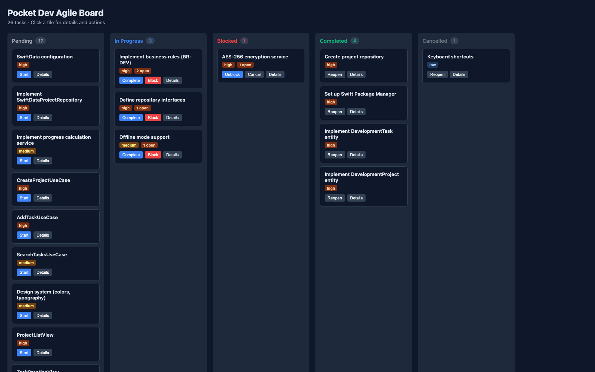

# Pocket Dev CLI & Kanban Board

Pocket Dev is the command-line interface and web board that operationalizes the Solo Agent Development Framework.

## Installation

```bash
npm install -g pocket-dev
# or, from a checkout:
npm install
npm run build
```

## Commands

### `pocket-dev init`

Interactively (or via flag) sets up framework integration for Claude, OpenCode, or Vibe.

```bash
pocket-dev init                 # prompts for integration choice
pocket-dev init --integration claude
pocket-dev init --integration opencode
pocket-dev init --integration vibe
```

Generates agent-specific files under `.framework/` and prints usage instructions.

### `pocket-dev status`

Shows project name, current phase, and task counts.

### `pocket-dev validate`

Runs the framework consistency check (`framework-check.sh`).

### `pocket-dev deps`

Checks build/test availability (node, npm, git, swiftpm, etc.).

### `pocket-dev board`

Serves the interactive Kanban board.

```bash
pocket-dev board               # http://localhost:4173
pocket-dev board --port 4177
pocket-dev board --open
```

Tasks are read from `.framework/state.json`; when empty, the board falls back to the bundled demo tasks (26 tickets across 6 phases).

## Kanban Board



The board groups task tiles by status (Pending, In Progress, Blocked, Completed, Cancelled). Clicking a tile opens a drawer with open items, next steps, blocked reason, and action buttons (Start, Continue, Move to next status).

Task data model (`packages/shared`): see `Task`, `transitionTask`.

## Task lifecycle transitions

- `pending` → `in-progress` (Start)
- `in-progress` → `completed` (Complete) / `blocked`
- `blocked` → `in-progress` (Unblock)
